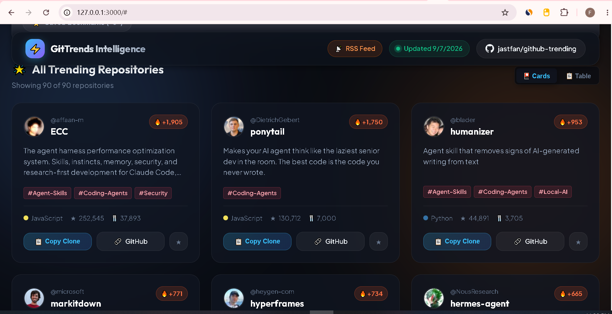

<div align="center">

# ⚡ GitTrends AI — Open Agent Intelligence Registry

**World-class Swiss Editorial developer registry and empirical research desk for Claude Code skills, MCP servers, and GitHub star velocity intelligence.**

[](https://jastfan.github.io/github-trending/)
[](https://www.npmjs.com/package/gittrends-mcp)
[](guides/mcp_servers_integration.md)
[](data/research/census_latest.json)
-2ea44f?style=for-the-badge&logo=github)


<sub>⚡ 79,848+ Listings • 164.8M Installs • Auto-updated 2x daily via GitHub Actions • Maintained by [@jastfan](https://github.com/jastfan/github-trending)</sub>

<br/>

```bash
# ⚡ 1-Click Coding Agent Integration (mid-task skill discovery for Claude Code & Cursor)
claude mcp add gittrends -- npx -y gittrends-mcp
```

<br/>
<a href="https://jastfan.github.io/github-trending/"></a>

<sub>👉 <b><a href="https://jastfan.github.io/github-trending/">Launch the Live Swiss Editorial Registry</a></b> with 4 Numbered Leaderboards, Interactive Inspector, Side-by-Side Comparison Matrix, and Terminal Prompt Simulator.</sub>

---

### 🧭 Registry Navigation

[`🌐 Live Web App`](https://jastfan.github.io/github-trending/) • [`⚡ Popular Skills`](#-hot-ai-llms-mcp--agent-skills-spotlight) • [`🔌 MCP Servers`](guides/mcp_servers_integration.md) • [`📊 Research Censuses`](data/research/census_latest.json) • [`📚 Developer Guides`](guides/README.md) • [`📡 RSS Feed`](feed.xml) • [`🗄️ JSON API`](#-structured-data-access-api)

<br/>

<table align="center" width="100%">
  <tr>
    <td align="center" width="25%"><b>🏆 4 Editorial Leaderboards</b><br/><sub>Skills, MCP, Hubs &amp; Velocity</sub></td>
    <td align="center" width="25%"><b>🔌 Native MCP Server</b><br/><sub>5 tools for autonomous agents</sub></td>
    <td align="center" width="25%"><b>📊 Empirical Research Desk</b><br/><sub>5 dated ecosystem censuses</sub></td>
    <td align="center" width="25%"><b>⚡ Live Agent Simulator</b><br/><sub>Terminal prompt testbench</sub></td>
  </tr>
</table>

</div>

---

## 🏆 Today's #1 Trending Breakout Project

[](https://github.com/GoogleChrome/modern-web-guidance-src)

> 💡 **What is it?** [GoogleChrome/modern-web-guidance-src](https://github.com/GoogleChrome/modern-web-guidance-src) — Keep your coding agent up to date with the latest web best practices
> 🚀 **Gained today:** **+1,225 stars** | **Total Stars:** ★ 5,705 | **Topics:** `#Coding-Agents`

<details>
<summary><b>👉 Click here for Instant Quick Inspect (Clone command & details)</b></summary>

```bash
# Clone this breakout repository directly:
git clone https://github.com/GoogleChrome/modern-web-guidance-src.git
```
- **Repository URL:** [https://github.com/GoogleChrome/modern-web-guidance-src](https://github.com/GoogleChrome/modern-web-guidance-src)
- **Owner:** `@GoogleChrome`
</details>

---

## 🔥 Today's Top 5 Breakout Repositories (Viral Momentum)

> Repositories with the highest star velocity across the entire GitHub ecosystem in the last 24 hours.

| Rank | Repository | Language | Trending Topics | Stars Today | Total Stars | Description |
| :---: | :--- | :---: | :---: | :---: | :---: | :--- |
| 1 | [**GoogleChrome/modern-web-guidance-src**](https://github.com/GoogleChrome/modern-web-guidance-src) | `TypeScript` | `#Coding-Agents` | 🔥 **+1,225** | ★ 5,705 | Keep your coding agent up to date with the latest web best practices |
| 2 | [**alibaba/open-code-review**](https://github.com/alibaba/open-code-review) | `Go` | `#Coding-Agents` | 🔥 **+897** | ★ 51,264 | Secure, fast, efficient, battle-tested at Alibaba's scale. Hybrid architecture code review tool: deterministic pipelines + LLM Agent, precise line-level comments, built-in multi-language ruleset (NPE, thread-safety, XSS, SQL injection), OpenAI & Anthropic compatible. |
| 3 | [**ChromeDevTools/chrome-devtools-mcp**](https://github.com/ChromeDevTools/chrome-devtools-mcp) | `TypeScript` | `#MCP` `#Coding-Agents` | 🔥 **+673** | ★ 56,161 | Chrome DevTools for coding agents |
| 4 | [**we-promise/sure**](https://github.com/we-promise/sure) | `Ruby` | - | 🔥 **+659** | ★ 15,165 | The personal finance app for everyone (by everyone) |
| 5 | [**openai/codex-security**](https://github.com/openai/codex-security) | `TypeScript` | `#Coding-Agents` `#Local-AI` `#Security` | 🔥 **+599** | ★ 13,500 | OpenAI's Codex Security CLI and TypeScript SDK for finding, validating, and fixing security vulnerabilities. npm: https://www.npmjs.com/package/@openai/codex-security |

---

## 🤖 Hot AI, LLMs, MCP & Agent Skills Spotlight

> Curated breakthroughs in Model Context Protocol (MCP), Agentic Frameworks, AI Video Generation, and Local LLMs.

| Rank | AI Repository | Language | Key Topic | Stars Today | Total Stars | What It Does |
| :---: | :--- | :---: | :---: | :---: | :---: | :--- |
| 1 | [**GoogleChrome/modern-web-guidance-src**](https://github.com/GoogleChrome/modern-web-guidance-src) | `TypeScript` | `#Coding-Agents` | 🔥 **+1,225** | ★ 5,705 | Keep your coding agent up to date with the latest web best practices |
| 2 | [**alibaba/open-code-review**](https://github.com/alibaba/open-code-review) | `Go` | `#Coding-Agents` | 🔥 **+897** | ★ 51,264 | Secure, fast, efficient, battle-tested at Alibaba's scale. Hybrid architecture code review tool: deterministic pipelines + LLM Agent, precise line-level comments, built-in multi-language ruleset (NPE, thread-safety, XSS, SQL injection), OpenAI & Anthropic compatible. |
| 3 | [**ChromeDevTools/chrome-devtools-mcp**](https://github.com/ChromeDevTools/chrome-devtools-mcp) | `TypeScript` | `#MCP` | 🔥 **+673** | ★ 56,161 | Chrome DevTools for coding agents |
| 4 | [**openai/codex-security**](https://github.com/openai/codex-security) | `TypeScript` | `#Coding-Agents` | 🔥 **+599** | ★ 13,500 | OpenAI's Codex Security CLI and TypeScript SDK for finding, validating, and fixing security vulnerabilities. npm: https://www.npmjs.com/package/@openai/codex-security |
| 5 | [**tradermonty/claude-trading-skills**](https://github.com/tradermonty/claude-trading-skills) | `Python` | `#Agent-Skills` | 🔥 **+556** | ★ 4,629 | Claude Code skills for equity investors and traders — market analysis, technical charting, economic calendars, screeners, and trading strategy development. |
| 6 | [**dream-num/univer**](https://github.com/dream-num/univer) | `TypeScript` | `#Coding-Agents` | 🔥 **+495** | ★ 24,358 | Build your own AI office with Univer Office SDK. Bring editing, calculation, collaboration, and file processing into your product for people and AI agents. Built on an extensible open-source core. |

---

## 📊 Language Category Dashboards

### 🌐 Overall Trending

| # | Repository | Language | Topics | Stars Today | Total Stars | Description |
| :---: | :--- | :---: | :---: | :---: | :---: | :--- |
| 1 | [**backnotprop/plannotator**](https://github.com/backnotprop/plannotator) | `TypeScript` | `#Coding-Agents` | **+412** | ★ 10,899 | The workspace to stay in the loop and on top of agents - shape, decide, plan, annotate, review code, share with team, and send all feedback to agents with one click. |
| 2 | [**GoogleChrome/modern-web-guidance-src**](https://github.com/GoogleChrome/modern-web-guidance-src) | `TypeScript` | `#Coding-Agents` | **+1,225** | ★ 5,705 | Keep your coding agent up to date with the latest web best practices |
| 3 | [**tradermonty/claude-trading-skills**](https://github.com/tradermonty/claude-trading-skills) | `Python` | `#Agent-Skills` `#Local-AI` `#Autonomous-Finance` | **+556** | ★ 4,629 | Claude Code skills for equity investors and traders — market analysis, technical charting, economic calendars, screeners, and trading strategy development. |
| 4 | [**ChromeDevTools/chrome-devtools-mcp**](https://github.com/ChromeDevTools/chrome-devtools-mcp) | `TypeScript` | `#MCP` `#Coding-Agents` | **+673** | ★ 56,161 | Chrome DevTools for coding agents |
| 5 | [**alibaba/open-code-review**](https://github.com/alibaba/open-code-review) | `Go` | `#Coding-Agents` | **+897** | ★ 51,264 | Secure, fast, efficient, battle-tested at Alibaba's scale. Hybrid architecture code review tool: deterministic pipelines + LLM Agent, precise line-level comments, built-in multi-language ruleset (NPE, thread-safety, XSS, SQL injection), OpenAI & Anthropic compatible. |
| 6 | [**QwenLM/qwen-code**](https://github.com/QwenLM/qwen-code) | `TypeScript` | `#Coding-Agents` | **+116** | ★ 30,243 | An open-source AI coding agent that lives in your terminal. |
| 7 | [**dream-num/univer**](https://github.com/dream-num/univer) | `TypeScript` | `#Coding-Agents` | **+495** | ★ 24,358 | Build your own AI office with Univer Office SDK. Bring editing, calculation, collaboration, and file processing into your product for people and AI agents. Built on an extensible open-source core. |
| 8 | [**ag-ui-protocol/ag-ui**](https://github.com/ag-ui-protocol/ag-ui) | `TypeScript` | `#Coding-Agents` | **+9** | ★ 17,265 | AG-UI: the Agent-User Interaction Protocol. Bring Agents into Frontend Applications. |

> 📂 *Explore all 15 Overall Trending repos in [`archives/2026-11/2026-11-14.md`](archives/2026-11/2026-11-14.md)*

### 🐍 Python

| # | Repository | Language | Topics | Stars Today | Total Stars | Description |
| :---: | :--- | :---: | :---: | :---: | :---: | :--- |
| 1 | [**tradermonty/claude-trading-skills**](https://github.com/tradermonty/claude-trading-skills) | `Python` | `#Agent-Skills` `#Local-AI` `#Autonomous-Finance` | **+556** | ★ 4,629 | Claude Code skills for equity investors and traders — market analysis, technical charting, economic calendars, screeners, and trading strategy development. |
| 2 | [**andrewyng/openworker**](https://github.com/andrewyng/openworker) | `Python` | - | **+94** | ★ 19,189 | No description provided. |
| 3 | [**elementalsouls/Claude-BugHunter**](https://github.com/elementalsouls/Claude-BugHunter) | `Python` | `#Agent-Skills` `#Local-AI` `#Security` | **+127** | ★ 5,820 | A Claude Code skill bundle for bug hunting and external red-team work - 82 skills, 15 slash commands, 681 disclosed-report patterns curated across 24 core vulnerability classes, plus enterprise identity + infrastructure attack matrices. |
| 4 | [**NVIDIA/SkillEvaluator**](https://github.com/NVIDIA/SkillEvaluator) | `Python` | `#Agent-Skills` `#Coding-Agents` `#Local-AI` | **+168** | ★ 1,215 | Multi-tier framework for evaluating AI agent skills with quality gates, semantic overlap detection, synthetic evaluation dataset generation, and live agent evaluation that measures how skills affect agent behavior. |
| 5 | [**Alishahryar1/free-claude-code**](https://github.com/Alishahryar1/free-claude-code) | `Python` | `#Coding-Agents` `#Web3` | **+367** | ★ 70,150 | Use Claude Code, Codex, Antigravity, VSCode, Pi, and OpenCode (and 6 other harnesses) for free (1.3B+ free tokens) from your terminal, app, IDE, or phone, and now from the browser with native browser sessions (multi-harness + multi-model) like OpenClaw (voice supported + ToS friendly) |
| 6 | [**anthropics/claude-plugins-official**](https://github.com/anthropics/claude-plugins-official) | `Python` | - | **+137** | ★ 47,275 | Official, Anthropic-managed directory of high quality Claude Code Plugins. |
| 7 | [**pnnbao97/VieNeu-TTS**](https://github.com/pnnbao97/VieNeu-TTS) | `Python` | `#Local-AI` | **+37** | ★ 3,327 | Vietnamese TTS with instant voice cloning • On-device • Real-time CPU inference • 48kHz audio quality • Chuyển văn bản thành giọng nói tiếng Việt • Text to speech tiếng Việt • TTS tiếng Việt |
| 8 | [**0x0funky/agent-sprite-forge**](https://github.com/0x0funky/agent-sprite-forge) | `Python` | `#Agent-Skills` `#Coding-Agents` `#Local-AI` | **+56** | ★ 5,724 | Agent Skill for generating 2D sprite sheets and map, transparent PNG frames, and animated GIFs from prompts. |

> 📂 *Explore all 17 Python repos in [`archives/2026-11/2026-11-14.md`](archives/2026-11/2026-11-14.md)*

### ⚡ JavaScript

| # | Repository | Language | Topics | Stars Today | Total Stars | Description |
| :---: | :--- | :---: | :---: | :---: | :---: | :--- |
| 1 | [**louislam/uptime-kuma**](https://github.com/louislam/uptime-kuma) | `JavaScript` | - | **+432** | ★ 94,150 | A fancy self-hosted monitoring tool |
| 2 | [**PenglongHuang/chinese-novelist-skill**](https://github.com/PenglongHuang/chinese-novelist-skill) | `JavaScript` | `#Agent-Skills` `#Coding-Agents` | **+37** | ★ 4,922 | 🎭 AI 写小说：从零生成 10-50 章完整中文小说，三层问答 · 创作记忆 · 悬念钩子 · 自动校验，长篇网文连载皆宜｜开源免费，适配主流 coding agent｜🤝 Infistar.cc 赞助 · 注册送 $5｜AI novel writing skill |
| 3 | [**hanliang97/MatrixMedia**](https://github.com/hanliang97/MatrixMedia) | `JavaScript` | - | **+30** | ★ 1,320 | 视频矩阵工具 vue electorn puppeteer 批量发布 视频到各个视频平台 自媒体 矩阵 抖音 小红书 头条 视频号 快手等 ai 自动化 cli |
| 4 | [**microsoft/power-platform-skills**](https://github.com/microsoft/power-platform-skills) | `JavaScript` | `#Agent-Skills` `#Coding-Agents` | **+4** | ★ 1,149 | A plugin marketplace for GitHub Copilot and other AI agents that provides Power Platform development plugins, including reusable skills, agents, and commands for building and deploying solutions. |
| 5 | [**NginxProxyManager/nginx-proxy-manager**](https://github.com/NginxProxyManager/nginx-proxy-manager) | `JavaScript` | `#Local-AI` | **+15** | ★ 34,711 | Docker container for managing Nginx proxy hosts with a simple, powerful interface |
| 6 | [**addyosmani/agent-skills**](https://github.com/addyosmani/agent-skills) | `JavaScript` | `#Agent-Skills` `#Coding-Agents` | **+419** | ★ 117,480 | Production-grade engineering skills for AI coding agents. |
| 7 | [**GoogleChrome/lighthouse**](https://github.com/GoogleChrome/lighthouse) | `JavaScript` | - | **+21** | ★ 31,083 | Automated auditing, performance metrics, and best practices for the web. |
| 8 | [**juliangarnier/anime**](https://github.com/juliangarnier/anime) | `JavaScript` | - | **+71** | ★ 74,651 | JavaScript animation engine |

> 📂 *Explore all 8 JavaScript repos in [`archives/2026-11/2026-11-14.md`](archives/2026-11/2026-11-14.md)*

### 🔷 TypeScript

| # | Repository | Language | Topics | Stars Today | Total Stars | Description |
| :---: | :--- | :---: | :---: | :---: | :---: | :--- |
| 1 | [**backnotprop/plannotator**](https://github.com/backnotprop/plannotator) | `TypeScript` | `#Coding-Agents` | **+412** | ★ 10,899 | The workspace to stay in the loop and on top of agents - shape, decide, plan, annotate, review code, share with team, and send all feedback to agents with one click. |
| 2 | [**GoogleChrome/modern-web-guidance-src**](https://github.com/GoogleChrome/modern-web-guidance-src) | `TypeScript` | `#Coding-Agents` | **+1,225** | ★ 5,706 | Keep your coding agent up to date with the latest web best practices |
| 3 | [**ChromeDevTools/chrome-devtools-mcp**](https://github.com/ChromeDevTools/chrome-devtools-mcp) | `TypeScript` | `#MCP` `#Coding-Agents` | **+673** | ★ 56,161 | Chrome DevTools for coding agents |
| 4 | [**QwenLM/qwen-code**](https://github.com/QwenLM/qwen-code) | `TypeScript` | `#Coding-Agents` | **+116** | ★ 30,243 | An open-source AI coding agent that lives in your terminal. |
| 5 | [**dream-num/univer**](https://github.com/dream-num/univer) | `TypeScript` | `#Coding-Agents` | **+495** | ★ 24,358 | Build your own AI office with Univer Office SDK. Bring editing, calculation, collaboration, and file processing into your product for people and AI agents. Built on an extensible open-source core. |
| 6 | [**ag-ui-protocol/ag-ui**](https://github.com/ag-ui-protocol/ag-ui) | `TypeScript` | `#Coding-Agents` | **+9** | ★ 17,265 | AG-UI: the Agent-User Interaction Protocol. Bring Agents into Frontend Applications. |
| 7 | [**lidge-jun/opencodex**](https://github.com/lidge-jun/opencodex) | `TypeScript` | `#Coding-Agents` `#Local-AI` | **+49** | ★ 18,531 | Universal provider proxy for OpenAI Codex & Claude Code — use any LLM (Claude, Gemini, Grok, DeepSeek, Ollama…) with Codex CLI, App, SDK, and Claude Code |
| 8 | [**CopilotKit/OpenBot**](https://github.com/CopilotKit/OpenBot) | `TypeScript` | `#Coding-Agents` | **+209** | ★ 12,243 | Open-source AI coworkers that each get a computer of their own: a browser, files and tools, with every action decided before it happens and recorded after. Bring any AG-UI agent. |

> 📂 *Explore all 15 TypeScript repos in [`archives/2026-11/2026-11-14.md`](archives/2026-11/2026-11-14.md)*

### 🐹 Go

| # | Repository | Language | Topics | Stars Today | Total Stars | Description |
| :---: | :--- | :---: | :---: | :---: | :---: | :--- |
| 1 | [**alibaba/open-code-review**](https://github.com/alibaba/open-code-review) | `Go` | `#Coding-Agents` | **+897** | ★ 51,264 | Secure, fast, efficient, battle-tested at Alibaba's scale. Hybrid architecture code review tool: deterministic pipelines + LLM Agent, precise line-level comments, built-in multi-language ruleset (NPE, thread-safety, XSS, SQL injection), OpenAI & Anthropic compatible. |
| 2 | [**JuliusBrussee/caveman**](https://github.com/JuliusBrussee/caveman) | `Go` | `#Agent-Skills` `#Coding-Agents` `#Web3` | **+227** | ★ 119,928 | 🪨 why use many token when few token do trick. Viral skill + proxy for coding agents that cuts 65% of tokens by talking like a caveman. |
| 3 | [**Tencent/LoopForge**](https://github.com/Tencent/LoopForge) | `Go` | `#Coding-Agents` | **+101** | ★ 800 | Self-hosted workflows for coding-agent delivery. Orchestrate CodeBuddy, Codex and Claude Code with scripts and human approval gates. Includes Local workflows for coding assistants. |
| 4 | [**tailscale/tailcat**](https://github.com/tailscale/tailcat) | `Go` | - | **+490** | ★ 9,787 | like netcat, but over Tailscale's data plane, without Tailscale's control plane |
| 5 | [**netbirdio/netbird**](https://github.com/netbirdio/netbird) | `Go` | `#Coding-Agents` | **+23** | ★ 30,992 | NetBird securely connects people, machines and AI agents across any network with one identity-based Zero Trust platform. Powered by peer-to-peer WireGuard® |
| 6 | [**restic/restic**](https://github.com/restic/restic) | `Go` | - | **+30** | ★ 37,223 | Fast, secure, efficient backup program |
| 7 | [**kubescape/kubescape**](https://github.com/kubescape/kubescape) | `Go` | `#Security` | **+12** | ★ 11,899 | Kubescape is an open-source Kubernetes security platform for your IDE, CI/CD pipelines, and clusters. It includes risk analysis, security, compliance, and misconfiguration scanning, saving Kubernetes users and administrators precious time, effort, and resources. |
| 8 | [**aquasecurity/trivy**](https://github.com/aquasecurity/trivy) | `Go` | `#Local-AI` | **+39** | ★ 39,342 | Find vulnerabilities, misconfigurations, secrets, SBOM in containers, Kubernetes, code repositories, clouds and more |

> 📂 *Explore all 15 Go repos in [`archives/2026-11/2026-11-14.md`](archives/2026-11/2026-11-14.md)*

### 🦀 Rust

| # | Repository | Language | Topics | Stars Today | Total Stars | Description |
| :---: | :--- | :---: | :---: | :---: | :---: | :--- |
| 1 | [**martin-olivier/airgorah**](https://github.com/martin-olivier/airgorah) | `Rust` | `#Security` | **+269** | ★ 5,673 | A WiFi security auditing software |
| 2 | [**ModernRelay/omnigraph**](https://github.com/ModernRelay/omnigraph) | `Rust` | - | **+212** | ★ 2,380 | Object-storage native graph database with branching and typed ontology |
| 3 | [**verus-lang/verus**](https://github.com/verus-lang/verus) | `Rust` | - | **+20** | ★ 3,778 | Verified Rust for low-level systems code |
| 4 | [**block/buzz**](https://github.com/block/buzz) | `Rust` | - | **+275** | ★ 37,438 | A hive mind communication platform |
| 5 | [**aaif-goose/goose**](https://github.com/aaif-goose/goose) | `Rust` | `#Coding-Agents` | **+72** | ★ 56,608 | an open source, extensible AI agent that goes beyond code suggestions - install, execute, edit, and test with any LLM |
| 6 | [**zeronsh/zeron**](https://github.com/zeronsh/zeron) | `Rust` | `#Coding-Agents` | **+60** | ★ 3,657 | A native control plane for Claude Code, Codex, Cursor, Devin and other coding agents. |
| 7 | [**rust-lang/rust-clippy**](https://github.com/rust-lang/rust-clippy) | `Rust` | - | **+4** | ★ 13,645 | A bunch of lints to catch common mistakes and improve your Rust code. Book: https://doc.rust-lang.org/clippy/ |
| 8 | [**lance-format/lance**](https://github.com/lance-format/lance) | `Rust` | - | **+6** | ★ 7,299 | Open Lakehouse Format for Multimodal AI. Convert from Parquet in 2 lines of code for 100x faster random access, vector index, and data versioning. Compatible with Pandas, DuckDB, Polars, Pyarrow, and PyTorch with more integrations coming.. |

> 📂 *Explore all 9 Rust repos in [`archives/2026-11/2026-11-14.md`](archives/2026-11/2026-11-14.md)*

---

## 🔌 1-Click Coding Agent Integration: `gittrends-mcp`

Connect Claude Code, Cursor, and Antigravity to the entire GitTrends AI registry mid-task with zero manual downloads.

### 1. Claude Code
```bash
claude mcp add gittrends -- npx -y gittrends-mcp
```

### 2. Cursor IDE (`.cursor/mcp.json`)
```json
{
  "mcpServers": {
    "gittrends": {
      "command": "npx",
      "args": ["-y", "gittrends-mcp"]
    }
  }
}
```

### 3. Antigravity IDE (`mcp_config.json`)
```json
{
  "mcpServers": {
    "gittrends": {
      "command": "npx",
      "args": ["-y", "gittrends-mcp"]
    }
  }
}
```

### 🛠️ Exposed MCP Tools
1. `find_agent_skills(query, category, limit)`: Query 59k+ categorized skills with 1-click install snippets.
2. `inspect_mcp_servers(query, category, limit)`: Inspect stdio and SSE servers with auto-generated configuration JSON.
3. `get_trending_breakouts(language, min_stars_today, limit)`: Retrieve GitHub breakout repositories with star velocity classification.
4. `get_census_report(census_id)`: Access empirical data on agent skill security, distribution, and code maintenance.
5. `get_ecosystem_stats()`: Macro benchmarks on total listings, installs, and domain leaders.

---

## 📊 2026 Empirical Research Censuses

GitTrends AI indexes the agent ecosystem and runs ongoing empirical research with open datasets free to cite:

| Census Report | Key Finding | Raw Dataset | Methodology |
| :--- | :--- | :---: | :---: |
| **The Agent Economy Census** | Install Gini 0.96; 0.07% of listings paid | [JSON](data/research/census_latest.json) | [Guide](guides/research_census_2026.md) |
| **The Agent Skill Security Census** | 87.8% of listings never audited; 34% request shell | [JSON](data/research/census_latest.json) | [Guide](guides/research_census_2026.md) |
| **The Agent Skill Clone Census** | 15.8% of all secondary installs land on repackaged copies | [JSON](data/research/census_latest.json) | [Guide](guides/research_census_2026.md) |
| **The Agent Use-Case Census** | Generative media leads at 20.8% of installs | [JSON](data/research/census_latest.json) | [Guide](guides/research_census_2026.md) |
| **The Agent Skill Maintenance Census** | Install-weighted median code age: 6 days | [JSON](data/research/census_latest.json) | [Guide](guides/research_census_2026.md) |

---

## 🗄️ Structured Data Access (API)

Developers can access live tracking data directly via machine-readable JSON or RSS:

- 🌐 **Live Web Application**: [https://jastfan.github.io/github-trending/](https://jastfan.github.io/github-trending/)
- 📡 **Daily RSS 2.0 Feed**: [`feed.xml`](feed.xml)
- 🗄️ **Direct Latest JSON**: [`data/latest.json`](data/latest.json)
- 📊 **Research Censuses JSON**: [`data/research/census_latest.json`](data/research/census_latest.json)
- 📅 **Historical Archives**: Browse [`archives/`](archives/) organized by `YYYY-MM/`

---

## ⚙️ How It Works (Zero-Maintenance Automation)

- **Cloud Scheduled**: GitHub Actions runs automatically in the cloud every 12 hours. Zero manual intervention required.
- **Topic Extraction**: Analyzes repository descriptions against real-time taxonomies (#MCP, #Agent-Skills, #AI-Video, #Local-AI).
- **Anti-Blocking Protocol**: Uses rotating browser headers, connection pooling, and automatic GitHub API fallbacks.

```bash
# Run locally to generate latest intelligence:
python engine.py
```

---

## 📄 License

Maintained with ❤️ by [jastfan](https://github.com/jastfan/github-trending). Licensed under the [MIT License](LICENSE).
