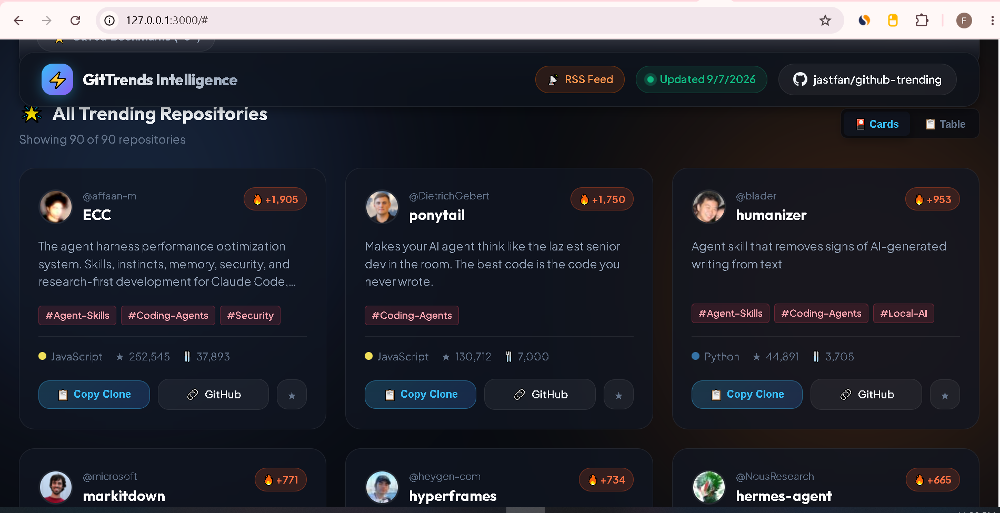

<div align="center">

# ⚡ GitTrends AI — Open Agent Intelligence Registry

**World-class Swiss Editorial developer registry and empirical research desk for Claude Code skills, MCP servers, and GitHub star velocity intelligence.**

[](https://jastfan.github.io/github-trending/)
[](https://www.npmjs.com/package/gittrends-mcp)
[](guides/mcp_servers_integration.md)
[](data/research/census_latest.json)
-2ea44f?style=for-the-badge&logo=github)


<sub>⚡ 79,848+ Listings • 164.8M Installs • Auto-updated 2x daily via GitHub Actions • Maintained by [@jastfan](https://github.com/jastfan/github-trending)</sub>

<br/>

```bash
# ⚡ 1-Click Coding Agent Integration (mid-task skill discovery for Claude Code & Cursor)
claude mcp add gittrends -- npx -y gittrends-mcp
```

<br/>
<a href="https://jastfan.github.io/github-trending/"></a>

<sub>👉 <b><a href="https://jastfan.github.io/github-trending/">Launch the Live Swiss Editorial Registry</a></b> with 4 Numbered Leaderboards, Interactive Inspector, Side-by-Side Comparison Matrix, and Terminal Prompt Simulator.</sub>

---

### 🧭 Registry Navigation

[`🌐 Live Web App`](https://jastfan.github.io/github-trending/) • [`⚡ Popular Skills`](#-hot-ai-llms-mcp--agent-skills-spotlight) • [`🔌 MCP Servers`](guides/mcp_servers_integration.md) • [`📊 Research Censuses`](data/research/census_latest.json) • [`📚 Developer Guides`](guides/README.md) • [`📡 RSS Feed`](feed.xml) • [`🗄️ JSON API`](#-structured-data-access-api)

<br/>

<table align="center" width="100%">
  <tr>
    <td align="center" width="25%"><b>🏆 4 Editorial Leaderboards</b><br/><sub>Skills, MCP, Hubs &amp; Velocity</sub></td>
    <td align="center" width="25%"><b>🔌 Native MCP Server</b><br/><sub>5 tools for autonomous agents</sub></td>
    <td align="center" width="25%"><b>📊 Empirical Research Desk</b><br/><sub>5 dated ecosystem censuses</sub></td>
    <td align="center" width="25%"><b>⚡ Live Agent Simulator</b><br/><sub>Terminal prompt testbench</sub></td>
  </tr>
</table>

</div>

---

## 🏆 Today's #1 Trending Breakout Project

[](https://github.com/morluto/rea)

> 💡 **What is it?** [morluto/rea](https://github.com/morluto/rea) — Reverse engineer anything with agents, from app behavior down to native binaries.
> 🚀 **Gained today:** **+23,584 stars** | **Total Stars:** ★ 293,428 | **Topics:** `#Coding-Agents`

<details>
<summary><b>👉 Click here for Instant Quick Inspect (Clone command & details)</b></summary>

```bash
# Clone this breakout repository directly:
git clone https://github.com/morluto/rea.git
```
- **Repository URL:** [https://github.com/morluto/rea](https://github.com/morluto/rea)
- **Owner:** `@morluto`
</details>

---

## 🔥 Today's Top 5 Breakout Repositories (Viral Momentum)

> Repositories with the highest star velocity across the entire GitHub ecosystem in the last 24 hours.

| Rank | Repository | Language | Trending Topics | Stars Today | Total Stars | Description |
| :---: | :--- | :---: | :---: | :---: | :---: | :--- |
| 1 | [**morluto/rea**](https://github.com/morluto/rea) | `TypeScript` | `#Coding-Agents` | 🔥 **+23,584** | ★ 293,428 | Reverse engineer anything with agents, from app behavior down to native binaries. |
| 2 | [**debpalash/VoiceStudio**](https://github.com/debpalash/VoiceStudio) | `Python` | `#AI-Video` | 🔥 **+2,301** | ★ 71,530 | VoiceStudio is the open-source, fully-local ElevenLabs alternative — voice cloning, voice design, video dubbing, dictation, transcription & audiobook creation in 646 languages. |
| 3 | [**xerj-org/xerj**](https://github.com/xerj-org/xerj) | `Rust` | `#Coding-Agents` `#Security` `#Web3` | 🔥 **+1,648** | ★ 7,068 | XERJ is the new way for AI to search data. Its autoindex capability activates agents to know your data without the token waste of grep and sed. One command indexes code, docs, logs and PDFs for search, RAG, security audits and agent memory, using 40x fewer tokens than grep. Elasticsearch compatible, so existing clients just work. |
| 4 | [**anthropics/claude-plugins-official**](https://github.com/anthropics/claude-plugins-official) | `Python` | - | 🔥 **+1,552** | ★ 40,771 | Official, Anthropic-managed directory of high quality Claude Code Plugins. |
| 5 | [**K-Dense-AI/scientific-agent-skills**](https://github.com/K-Dense-AI/scientific-agent-skills) | `Python` | `#Agent-Skills` `#Coding-Agents` | 🔥 **+1,158** | ★ 51,642 | Turn any AI agent into an AI Scientist. The #1 Agent Skills library for science, used by 250,000+ scientists worldwide. 177 ready-to-use validated skills plus 100+ scientific databases covering biology, chemistry, medicine, and drug discovery. Compatible with Cursor, Claude Code, Codex, Pi, Antigravity, and the open Agent Skills standard. |

---

## 🤖 Hot AI, LLMs, MCP & Agent Skills Spotlight

> Curated breakthroughs in Model Context Protocol (MCP), Agentic Frameworks, AI Video Generation, and Local LLMs.

| Rank | AI Repository | Language | Key Topic | Stars Today | Total Stars | What It Does |
| :---: | :--- | :---: | :---: | :---: | :---: | :--- |
| 1 | [**morluto/rea**](https://github.com/morluto/rea) | `TypeScript` | `#Coding-Agents` | 🔥 **+23,584** | ★ 293,428 | Reverse engineer anything with agents, from app behavior down to native binaries. |
| 2 | [**debpalash/VoiceStudio**](https://github.com/debpalash/VoiceStudio) | `Python` | `#AI-Video` | 🔥 **+2,301** | ★ 71,530 | VoiceStudio is the open-source, fully-local ElevenLabs alternative — voice cloning, voice design, video dubbing, dictation, transcription & audiobook creation in 646 languages. |
| 3 | [**xerj-org/xerj**](https://github.com/xerj-org/xerj) | `Rust` | `#Coding-Agents` | 🔥 **+1,648** | ★ 7,068 | XERJ is the new way for AI to search data. Its autoindex capability activates agents to know your data without the token waste of grep and sed. One command indexes code, docs, logs and PDFs for search, RAG, security audits and agent memory, using 40x fewer tokens than grep. Elasticsearch compatible, so existing clients just work. |
| 4 | [**anthropics/claude-plugins-official**](https://github.com/anthropics/claude-plugins-official) | `Python` | `#AI` | 🔥 **+1,552** | ★ 40,771 | Official, Anthropic-managed directory of high quality Claude Code Plugins. |
| 5 | [**K-Dense-AI/scientific-agent-skills**](https://github.com/K-Dense-AI/scientific-agent-skills) | `Python` | `#Agent-Skills` | 🔥 **+1,158** | ★ 51,642 | Turn any AI agent into an AI Scientist. The #1 Agent Skills library for science, used by 250,000+ scientists worldwide. 177 ready-to-use validated skills plus 100+ scientific databases covering biology, chemistry, medicine, and drug discovery. Compatible with Cursor, Claude Code, Codex, Pi, Antigravity, and the open Agent Skills standard. |
| 6 | [**stablyai/orca**](https://github.com/stablyai/orca) | `TypeScript` | `#Coding-Agents` | 🔥 **+1,102** | ★ 94,609 | Orca is the place for working with a fleet of agents (e.g. Grok Bot, Codex). Run any coding agent with your own subscription. Available on desktop, mobile and remote runtime. |

---

## 📊 Language Category Dashboards

### 🌐 Overall Trending

| # | Repository | Language | Topics | Stars Today | Total Stars | Description |
| :---: | :--- | :---: | :---: | :---: | :---: | :--- |
| 1 | [**anthropics/claude-plugins-official**](https://github.com/anthropics/claude-plugins-official) | `Python` | - | **+1,552** | ★ 40,771 | Official, Anthropic-managed directory of high quality Claude Code Plugins. |
| 2 | [**K-Dense-AI/scientific-agent-skills**](https://github.com/K-Dense-AI/scientific-agent-skills) | `Python` | `#Agent-Skills` `#Coding-Agents` | **+1,158** | ★ 51,642 | Turn any AI agent into an AI Scientist. The #1 Agent Skills library for science, used by 250,000+ scientists worldwide. 177 ready-to-use validated skills plus 100+ scientific databases covering biology, chemistry, medicine, and drug discovery. Compatible with Cursor, Claude Code, Codex, Pi, Antigravity, and the open Agent Skills standard. |
| 3 | [**affaan-m/ECC**](https://github.com/affaan-m/ECC) | `JavaScript` | `#Agent-Skills` `#Coding-Agents` `#Security` | **+1,057** | ★ 281,644 | The agent harness performance optimization system. Skills, instincts, memory, security, and research-first development for Claude Code, Codex, Opencode, Cursor and beyond. |
| 4 | [**HKUDS/CLI-Anything**](https://github.com/HKUDS/CLI-Anything) | `Python` | `#Coding-Agents` | **+281** | ★ 53,594 | "CLI-Anything: Making ALL Software Agent-Native" -- CLI-Hub: https://clianything.cc/ |
| 5 | [**mksglu/context-mode**](https://github.com/mksglu/context-mode) | `TypeScript` | `#MCP` `#Coding-Agents` | **+449** | ★ 30,288 | Context window optimization for AI coding agents. Sandboxes tool output (98% reduction), persists session memory, and enforces routing across 17 platforms via MCP + hooks. |
| 6 | [**ruvnet/ruflo**](https://github.com/ruvnet/ruflo) | `TypeScript` | `#Coding-Agents` | **+672** | ★ 75,701 | 🌊 The original agent harness. Deploy intelligent multi-player swarms, coordinate autonomous workflows, and build conversational AI systems. Features adaptive memory, self-learning intelligence, federation, vector RAG integration, and native Claude Code / Codex / Hermes and many more Integrated |
| 7 | [**android/skills**](https://github.com/android/skills) | `Kotlin` | `#Agent-Skills` | **+36** | ★ 8,138 | No description provided. |
| 8 | [**obra/superpowers**](https://github.com/obra/superpowers) | `Shell` | `#Agent-Skills` `#Coding-Agents` | **+973** | ★ 300,755 | An agentic skills framework & software development methodology that works. |

> 📂 *Explore all 13 Overall Trending repos in [`archives/2026-10/2026-10-17.md`](archives/2026-10/2026-10-17.md)*

### 🐍 Python

| # | Repository | Language | Topics | Stars Today | Total Stars | Description |
| :---: | :--- | :---: | :---: | :---: | :---: | :--- |
| 1 | [**anthropics/claude-plugins-official**](https://github.com/anthropics/claude-plugins-official) | `Python` | - | **+1,552** | ★ 40,771 | Official, Anthropic-managed directory of high quality Claude Code Plugins. |
| 2 | [**K-Dense-AI/scientific-agent-skills**](https://github.com/K-Dense-AI/scientific-agent-skills) | `Python` | `#Agent-Skills` `#Coding-Agents` | **+1,158** | ★ 51,642 | Turn any AI agent into an AI Scientist. The #1 Agent Skills library for science, used by 250,000+ scientists worldwide. 177 ready-to-use validated skills plus 100+ scientific databases covering biology, chemistry, medicine, and drug discovery. Compatible with Cursor, Claude Code, Codex, Pi, Antigravity, and the open Agent Skills standard. |
| 3 | [**HKUDS/CLI-Anything**](https://github.com/HKUDS/CLI-Anything) | `Python` | `#Coding-Agents` | **+281** | ★ 53,594 | "CLI-Anything: Making ALL Software Agent-Native" -- CLI-Hub: https://clianything.cc/ |
| 4 | [**debpalash/VoiceStudio**](https://github.com/debpalash/VoiceStudio) | `Python` | `#AI-Video` | **+2,301** | ★ 71,530 | VoiceStudio is the open-source, fully-local ElevenLabs alternative — voice cloning, voice design, video dubbing, dictation, transcription & audiobook creation in 646 languages. |
| 5 | [**MadsLorentzen/ai-job-search**](https://github.com/MadsLorentzen/ai-job-search) | `Python` | - | **+898** | ★ 48,735 | The job search that runs on your machine. AI job application framework built on Claude Code: evaluate postings, tailor CVs, write cover letters, prep interviews. Fork it and own it. |
| 6 | [**lightseekorg/tokenspeed**](https://github.com/lightseekorg/tokenspeed) | `Python` | `#Web3` | **+308** | ★ 2,673 | TokenSpeed is a speed-of-light LLM inference engine. |
| 7 | [**elder-plinius/V3R1T4S**](https://github.com/elder-plinius/V3R1T4S) | `C` | - | **+40** | ★ 367 | liberating known unknowns |
| 8 | [**Crosstalk-Solutions/unifi-toolkit**](https://github.com/Crosstalk-Solutions/unifi-toolkit) | `Python` | - | **+35** | ★ 686 | A suite of tools for UniFi network management |

> 📂 *Explore all 15 Python repos in [`archives/2026-10/2026-10-17.md`](archives/2026-10/2026-10-17.md)*

### ⚡ JavaScript

| # | Repository | Language | Topics | Stars Today | Total Stars | Description |
| :---: | :--- | :---: | :---: | :---: | :---: | :--- |
| 1 | [**affaan-m/ECC**](https://github.com/affaan-m/ECC) | `JavaScript` | `#Agent-Skills` `#Coding-Agents` `#Security` | **+1,057** | ★ 281,644 | The agent harness performance optimization system. Skills, instincts, memory, security, and research-first development for Claude Code, Codex, Opencode, Cursor and beyond. |
| 2 | [**hmjz100/LinkSwift**](https://github.com/hmjz100/LinkSwift) | `JavaScript` | - | **+538** | ★ 23,893 | 一个基于 JavaScript 的网盘文件下载地址获取工具。基于【网盘直链下载助手】修改 ，支持 百度网盘 / 阿里云盘 / 中国移动云盘 / 天翼云盘 / 迅雷云盘 / 夸克网盘 / UC网盘 / 123云盘 八大网盘 |
| 3 | [**michael-denyer/pstack-claude**](https://github.com/michael-denyer/pstack-claude) | `JavaScript` | `#Coding-Agents` | **+420** | ★ 2,692 | Claude Code, Codex, Copilot, Pi, OpenCode, Gemini, and Prime Agent versions of Poteto's pstack. Rigorous agent workflows with Cursor primitives translated for other harnesses. |
| 4 | [**superdesigndev/superdesign-skill**](https://github.com/superdesigndev/superdesign-skill) | `JavaScript` | `#Agent-Skills` `#Coding-Agents` | **+40** | ★ 820 | The design skill for Claude Code, Cursor and any coding agent. Stop shipping AI-slop UI: turn it into shippable, tasteful frontend. Install: npx skills add superdesigndev/superdesign-skill. Powered by superdesign.dev |
| 5 | [**laoma528/awesome-zhuiju-free**](https://github.com/laoma528/awesome-zhuiju-free) | `JavaScript` | - | **+87** | ★ 12,440 | 免费无广告的追剧资源指南，人工精选资源、每天检测资源有效性。收录在线影视、影视APP、网盘搜索、磁力BT、字幕、TVBox / 影视仓空壳软件/配置地址、IPTV直播源、会员拼团、影视相关开源项目。开源，社区共同维护。 |
| 6 | [**plugin87/ux-ui-agent-skills**](https://github.com/plugin87/ux-ui-agent-skills) | `JavaScript` | `#Agent-Skills` `#Coding-Agents` `#Web3` | **+137** | ★ 2,018 | Turn Claude into a senior design architect: DTCG tokens, 52 components, WCAG 2.2 AA-AAA, 138 design systems, any-framework code, and 50 objective gates that fail the build instead of faking success. |
| 7 | [**github/awesome-copilot**](https://github.com/github/awesome-copilot) | `JavaScript` | `#Agent-Skills` `#Coding-Agents` | **+46** | ★ 40,101 | Community-contributed instructions, agents, skills, and configurations to help you make the most of GitHub Copilot. |
| 8 | [**kunchenguid/lavish-axi**](https://github.com/kunchenguid/lavish-axi) | `JavaScript` | - | **+25** | ★ 4,175 | HTML is the new markdown. Lavish is the new editor for your HTML artifacts. |

> 📂 *Explore all 8 JavaScript repos in [`archives/2026-10/2026-10-17.md`](archives/2026-10/2026-10-17.md)*

### 🔷 TypeScript

| # | Repository | Language | Topics | Stars Today | Total Stars | Description |
| :---: | :--- | :---: | :---: | :---: | :---: | :--- |
| 1 | [**mksglu/context-mode**](https://github.com/mksglu/context-mode) | `TypeScript` | `#MCP` `#Coding-Agents` | **+449** | ★ 30,288 | Context window optimization for AI coding agents. Sandboxes tool output (98% reduction), persists session memory, and enforces routing across 17 platforms via MCP + hooks. |
| 2 | [**ruvnet/ruflo**](https://github.com/ruvnet/ruflo) | `TypeScript` | `#Coding-Agents` | **+672** | ★ 75,701 | 🌊 The original agent harness. Deploy intelligent multi-player swarms, coordinate autonomous workflows, and build conversational AI systems. Features adaptive memory, self-learning intelligence, federation, vector RAG integration, and native Claude Code / Codex / Hermes and many more Integrated |
| 3 | [**cursor/plugins**](https://github.com/cursor/plugins) | `TypeScript` | `#Coding-Agents` | **+278** | ★ 12,032 | Cursor plugin specification and official plugins |
| 4 | [**stablyai/orca**](https://github.com/stablyai/orca) | `TypeScript` | `#Coding-Agents` | **+1,102** | ★ 94,609 | Orca is the place for working with a fleet of agents (e.g. Grok Bot, Codex). Run any coding agent with your own subscription. Available on desktop, mobile and remote runtime. |
| 5 | [**OpenCut-app/OpenCut**](https://github.com/OpenCut-app/OpenCut) | `TypeScript` | - | **+257** | ★ 94,999 | The open-source CapCut alternative |
| 6 | [**anomalyco/opencode**](https://github.com/anomalyco/opencode) | `TypeScript` | `#Coding-Agents` | **+488** | ★ 214,414 | The open source coding agent. |
| 7 | [**heygen-com/hyperframes**](https://github.com/heygen-com/hyperframes) | `TypeScript` | `#Coding-Agents` `#AI-Video` | **+822** | ★ 65,421 | Write HTML. Render video. Built for agents. |
| 8 | [**desktop/desktop**](https://github.com/desktop/desktop) | `TypeScript` | - | **+7** | ★ 21,966 | Focus on what matters instead of fighting with Git. |

> 📂 *Explore all 16 TypeScript repos in [`archives/2026-10/2026-10-17.md`](archives/2026-10/2026-10-17.md)*

### 🐹 Go

| # | Repository | Language | Topics | Stars Today | Total Stars | Description |
| :---: | :--- | :---: | :---: | :---: | :---: | :--- |
| 1 | [**JuliusBrussee/caveman**](https://github.com/JuliusBrussee/caveman) | `Go` | `#Agent-Skills` `#Coding-Agents` `#Web3` | **+828** | ★ 113,088 | 🪨 why use many token when few token do trick. Viral skill + proxy for coding agents that cuts 65% of tokens by talking like a caveman. |
| 2 | [**gitleaks/gitleaks**](https://github.com/gitleaks/gitleaks) | `Go` | - | **+54** | ★ 30,046 | Find secrets with Gitleaks 🔑 |
| 3 | [**tristenlammi/Arrmada**](https://github.com/tristenlammi/Arrmada) | `Go` | - | **+50** | ★ 273 | arrrrrrrr |
| 4 | [**vxcontrol/pentagi**](https://github.com/vxcontrol/pentagi) | `Go` | `#Coding-Agents` `#Security` | **+368** | ★ 30,773 | Fully autonomous AI Agents system capable of performing complex penetration testing tasks |
| 5 | [**Tencent/WeKnora**](https://github.com/Tencent/WeKnora) | `Go` | `#Coding-Agents` | **+218** | ★ 34,418 | Open-source LLM knowledge platform: turn raw documents into a queryable RAG, an autonomous reasoning agent, and a self-maintaining Wiki. |
| 6 | [**cilium/cilium**](https://github.com/cilium/cilium) | `Go` | `#Security` | **+11** | ★ 25,671 | eBPF-based Networking, Security, and Observability |
| 7 | [**jasonxu114514/opencode2api**](https://github.com/jasonxu114514/opencode2api) | `Go` | `#Coding-Agents` | **+185** | ★ 907 | A Go-based OpenCode Zen / Zen Go API proxy with OpenAI & Anthropic API compatibility, key/proxy pooling, automatic routing, and WebUI. |
| 8 | [**sipeed/picoclaw**](https://github.com/sipeed/picoclaw) | `Go` | - | **+41** | ★ 30,079 | Tiny, Fast, and Deployable anywhere — automate the mundane, unleash your creativity |

> 📂 *Explore all 20 Go repos in [`archives/2026-10/2026-10-17.md`](archives/2026-10/2026-10-17.md)*

### 🦀 Rust

| # | Repository | Language | Topics | Stars Today | Total Stars | Description |
| :---: | :--- | :---: | :---: | :---: | :---: | :--- |
| 1 | [**xerj-org/xerj**](https://github.com/xerj-org/xerj) | `Rust` | `#Coding-Agents` `#Security` `#Web3` | **+1,648** | ★ 7,068 | XERJ is the new way for AI to search data. Its autoindex capability activates agents to know your data without the token waste of grep and sed. One command indexes code, docs, logs and PDFs for search, RAG, security audits and agent memory, using 40x fewer tokens than grep. Elasticsearch compatible, so existing clients just work. |
| 2 | [**ruvnet/RuView**](https://github.com/ruvnet/RuView) | `Rust` | `#AI-Video` | **+210** | ★ 98,374 | π RuView turns commodity WiFi signals into real-time spatial intelligence, vital sign monitoring, and presence detection — all without a single pixel of video. |
| 3 | [**akitaonrails/ai-memory**](https://github.com/akitaonrails/ai-memory) | `Rust` | `#Coding-Agents` | **+159** | ★ 9,632 | Solution for long term memory for agent coding CLIs and to facilitate handoff between different agent vendors |
| 4 | [**cloud-hypervisor/cloud-hypervisor**](https://github.com/cloud-hypervisor/cloud-hypervisor) | `Rust` | `#Security` | **+17** | ★ 6,378 | A Virtual Machine Monitor for modern Cloud workloads. Features include CPU, memory and device hotplug, support for running Windows and Linux guests, device offload with vhost-user and a minimal compact footprint. Written in Rust with a strong focus on security. |
| 5 | [**hydra-db/hydradb**](https://github.com/hydra-db/hydradb) | `Rust` | - | **+15** | ★ 13,047 | HydraDB - fast graph database on object storage |
| 6 | [**rtk-ai/rtk**](https://github.com/rtk-ai/rtk) | `Rust` | `#Web3` | **+149** | ★ 83,633 | CLI proxy that reduces LLM token consumption by 60-90% on common dev commands. Single Rust binary, zero dependencies |
| 7 | [**pollen-robotics/microduck**](https://github.com/pollen-robotics/microduck) | `Rust` | - | **+41** | ★ 9,497 | A Tiny biped duck robot 🦆 |
| 8 | [**voidzero-dev/vite-plus**](https://github.com/voidzero-dev/vite-plus) | `Rust` | - | **+87** | ★ 6,329 | The unified toolchain and entry point for web development. |

> 📂 *Explore all 12 Rust repos in [`archives/2026-10/2026-10-17.md`](archives/2026-10/2026-10-17.md)*

---

## 🔌 1-Click Coding Agent Integration: `gittrends-mcp`

Connect Claude Code, Cursor, and Antigravity to the entire GitTrends AI registry mid-task with zero manual downloads.

### 1. Claude Code
```bash
claude mcp add gittrends -- npx -y gittrends-mcp
```

### 2. Cursor IDE (`.cursor/mcp.json`)
```json
{
  "mcpServers": {
    "gittrends": {
      "command": "npx",
      "args": ["-y", "gittrends-mcp"]
    }
  }
}
```

### 3. Antigravity IDE (`mcp_config.json`)
```json
{
  "mcpServers": {
    "gittrends": {
      "command": "npx",
      "args": ["-y", "gittrends-mcp"]
    }
  }
}
```

### 🛠️ Exposed MCP Tools
1. `find_agent_skills(query, category, limit)`: Query 59k+ categorized skills with 1-click install snippets.
2. `inspect_mcp_servers(query, category, limit)`: Inspect stdio and SSE servers with auto-generated configuration JSON.
3. `get_trending_breakouts(language, min_stars_today, limit)`: Retrieve GitHub breakout repositories with star velocity classification.
4. `get_census_report(census_id)`: Access empirical data on agent skill security, distribution, and code maintenance.
5. `get_ecosystem_stats()`: Macro benchmarks on total listings, installs, and domain leaders.

---

## 📊 2026 Empirical Research Censuses

GitTrends AI indexes the agent ecosystem and runs ongoing empirical research with open datasets free to cite:

| Census Report | Key Finding | Raw Dataset | Methodology |
| :--- | :--- | :---: | :---: |
| **The Agent Economy Census** | Install Gini 0.96; 0.07% of listings paid | [JSON](data/research/census_latest.json) | [Guide](guides/research_census_2026.md) |
| **The Agent Skill Security Census** | 87.8% of listings never audited; 34% request shell | [JSON](data/research/census_latest.json) | [Guide](guides/research_census_2026.md) |
| **The Agent Skill Clone Census** | 15.8% of all secondary installs land on repackaged copies | [JSON](data/research/census_latest.json) | [Guide](guides/research_census_2026.md) |
| **The Agent Use-Case Census** | Generative media leads at 20.8% of installs | [JSON](data/research/census_latest.json) | [Guide](guides/research_census_2026.md) |
| **The Agent Skill Maintenance Census** | Install-weighted median code age: 6 days | [JSON](data/research/census_latest.json) | [Guide](guides/research_census_2026.md) |

---

## 🗄️ Structured Data Access (API)

Developers can access live tracking data directly via machine-readable JSON or RSS:

- 🌐 **Live Web Application**: [https://jastfan.github.io/github-trending/](https://jastfan.github.io/github-trending/)
- 📡 **Daily RSS 2.0 Feed**: [`feed.xml`](feed.xml)
- 🗄️ **Direct Latest JSON**: [`data/latest.json`](data/latest.json)
- 📊 **Research Censuses JSON**: [`data/research/census_latest.json`](data/research/census_latest.json)
- 📅 **Historical Archives**: Browse [`archives/`](archives/) organized by `YYYY-MM/`

---

## ⚙️ How It Works (Zero-Maintenance Automation)

- **Cloud Scheduled**: GitHub Actions runs automatically in the cloud every 12 hours. Zero manual intervention required.
- **Topic Extraction**: Analyzes repository descriptions against real-time taxonomies (#MCP, #Agent-Skills, #AI-Video, #Local-AI).
- **Anti-Blocking Protocol**: Uses rotating browser headers, connection pooling, and automatic GitHub API fallbacks.

```bash
# Run locally to generate latest intelligence:
python engine.py
```

---

## 📄 License

Maintained with ❤️ by [jastfan](https://github.com/jastfan/github-trending). Licensed under the [MIT License](LICENSE).
